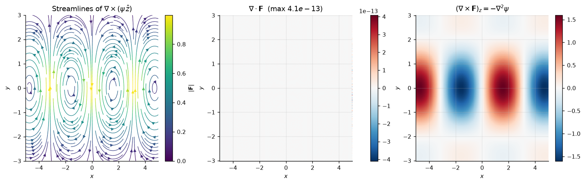
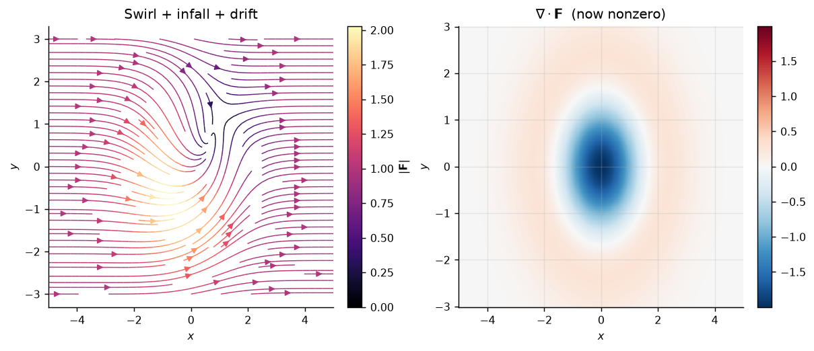
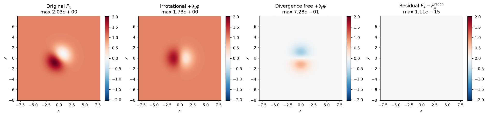

# 01 — Vector Fields and Potential Flow

Verification of the stream function construction and the Helmholtz decomposition
in two dimensions.



## Physics claim

1. A field $\mathbf{F} = \nabla\times(\psi\,\hat{z}) = (\partial_y\psi,\, -\partial_x\psi)$
   is divergence free identically, for any smooth $\psi$.
2. The numerical curl of that field reproduces $-\nabla^2\psi$ to second order.
3. A field with genuinely nonzero divergence admits **no** stream function, so
   the same test must fail.
4. Any periodic field decomposes uniquely as $\mathbf{F} = \nabla\phi +
   \nabla\times(\psi\,\hat{z})$.

## Why it matters

Galactic dynamics, accretion disk modelling, and the magnetohydrodynamic
interstellar medium are all written in this language. A divergence free velocity
field admits a stream function, and that scalar potential — not the velocity —
is what a code actually evolves. Every 2D incompressible hydrodynamics solver
starts from this construction.

## Equations

**Stream function**

$$\mathbf{F} = \nabla\times(\psi\,\hat{z}) = \left(\frac{\partial\psi}{\partial y},\; -\frac{\partial\psi}{\partial x}\right)$$

$$\nabla\cdot\mathbf{F} = \frac{\partial^2\psi}{\partial x\,\partial y} - \frac{\partial^2\psi}{\partial y\,\partial x} = 0$$

**Vorticity of that field**

$$\omega_z = \frac{\partial F_y}{\partial x} - \frac{\partial F_x}{\partial y} = -\nabla^2\psi$$

So divergence free does **not** imply curl free. The stream function is minus
the vorticity potential.

**Helmholtz decomposition** (2D, periodic domain)

$$\hat{\phi} = \frac{-i}{k^2}\left(k_x\hat{F}_x + k_y\hat{F}_y\right),
\qquad
\hat{\psi} = \frac{i}{k^2}\left(k_x\hat{F}_y - k_y\hat{F}_x\right)$$

$$\hat{F}_x = ik_x\hat\phi + ik_y\hat\psi, \qquad
\hat{F}_y = ik_y\hat\phi - ik_x\hat\psi$$

## Method

| Step | Technique |
|------|-----------|
| Stream function field | second-order central differences, `edge_order=2` |
| Convergence test | refine grid 101 → 1601, measure interior max error |
| Failure case | swirl (exactly divergence free) + radial infall $\nabla\cdot\mathbf{F} = (r^2/s^2 - 2)e^{-r^2/2s^2}$ + uniform drift |
| Decomposition | 2D FFT, divide by $k^2$, reconstruct |

Error is measured on the interior only. The boundary uses a different stencil,
so including it lets the edge dominate the maximum and flattens the apparent
convergence order.

## Results

### Divergence of the stream function field

```
  max |F|              0.999896
  max |div F|          4.088e-13
  max |curl F|         1.599553
  relative divergence  4.089e-13
```

The residual is round-off, not truncation error: two derivatives divide by
$h \approx 2.5\times10^{-2}$ twice, amplifying machine epsilon by roughly
$1/h^2 \approx 1600$.

### Convergence order of the numerical curl

| N | h | max error | ratio | order |
|---|------|-----------|-------|-------|
| 101 | 0.10000 | 8.483e-03 | — | — |
| 201 | 0.05000 | 2.127e-03 | 3.99 | 2.00 |
| 401 | 0.02500 | 5.322e-04 | 4.00 | 2.00 |
| 801 | 0.01250 | 1.331e-04 | 4.00 | 2.00 |
| 1601 | 0.00625 | 3.327e-05 | 4.00 | 2.00 |

Measured order **2.00** against a theoretical $O(h^2)$.

### A field with no stream function

```
  max |F|                     2.029314
  max |div F|                 1.999566
  relative divergence         0.9853
  numeric vs analytic div     4.340e-04
```

The divergence is 99% of the field magnitude. The analytic check confirms the
discretisation is still second order accurate; the field simply has no stream
function.



### Helmholtz decomposition

```
  max |F|                      2.028944
  max reconstruction residual  1.112e-15
  relative residual            5.482e-16
```

| Component | max \|div\| | max \|curl\| |
|-----------|-------------|--------------|
| irrotational $\nabla\phi$ | 1.997e+00 | **2.443e-04** |
| divergence free $\nabla\times(\psi\hat z)$ | **2.443e-04** | 1.997e+00 |

Each piece satisfies its defining condition to ~$10^{-4}$ while the field scale
is ~2, and the two recombine to machine precision.



## Two traps hit while writing this

Both produced confident, wrong output. They are recorded because they are easy
to repeat.

**Wrong sign in the irrotational piece.** The component checks passed while the
reconstruction residual sat at 1.2 — larger than the field itself. The
potentials $\hat\phi$ and $\hat\psi$ had correct signs, but the reconstruction
used $-\nabla\phi$ instead of $+\nabla\phi$. Algebraic check that settles it:

$$ik_x\hat\phi + ik_y\hat\psi
= \frac{k_x(k_x\hat F_x + k_y\hat F_y) - k_y(k_x\hat F_y - k_y\hat F_x)}{k^2}
= \frac{(k_x^2+k_y^2)\hat F_x}{k^2} = \hat F_x$$

**An analytic reference that was simply wrong.** Differentiating
$\sin x\,e^{-0.3y^2}$ as though the first factor were $x$ gives
$(\sin x - 0.6\cos x)e^{-0.3y^2}$ instead of the correct
$\sin x\,(-1.6 + 0.36y^2)e^{-0.3y^2}$. The error was constant under refinement,
which is the signature of a bad reference rather than a bad scheme — and a
convergence table that does not move is the check that catches it.

## Conclusion

All four claims confirmed. The stream function construction holds to round-off,
its convergence order matches theory, it fails exactly where the divergence is
nonzero, and the general Helmholtz decomposition reconstructs a field to
$5\times10^{-16}$ relative.

Component checks alone are not sufficient evidence for a decomposition; the
reconstruction residual is the test that actually constrains the signs.

## Reproducing

```bash
pip install numpy matplotlib
jupyter lab
```

Runtime is a few seconds. The FFT step uses only `numpy.fft`.

## Next

`02_ode_system_phase_portraits` — extend this to time evolution, which turns
the construction into a full incompressible hydrodynamics solver.
